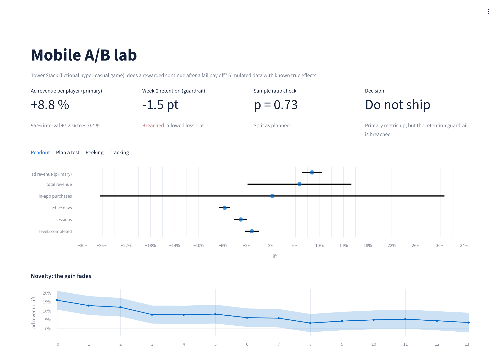
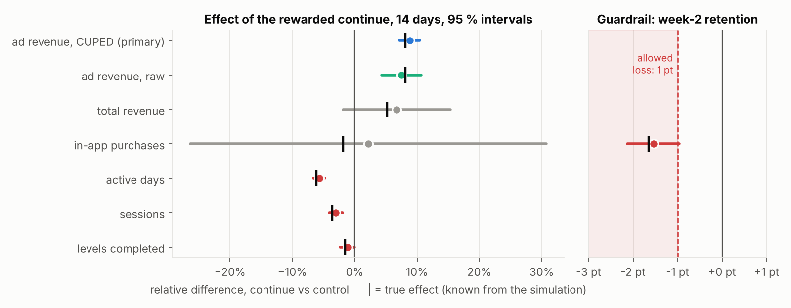
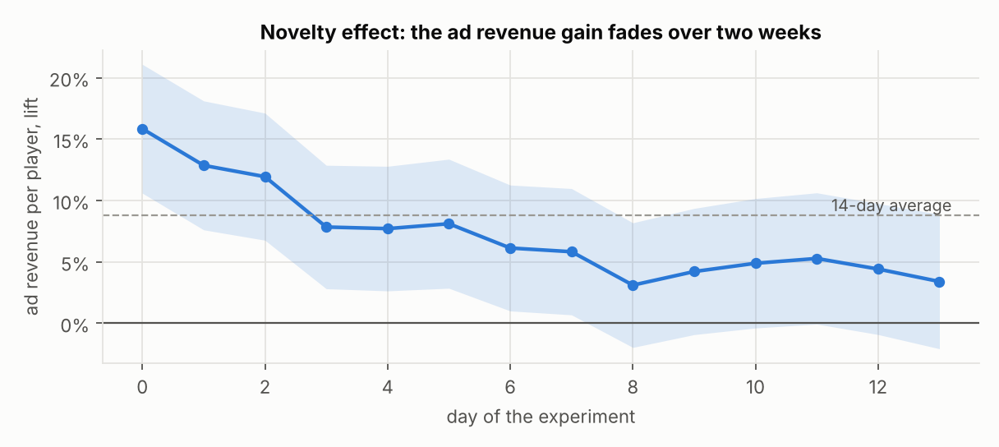
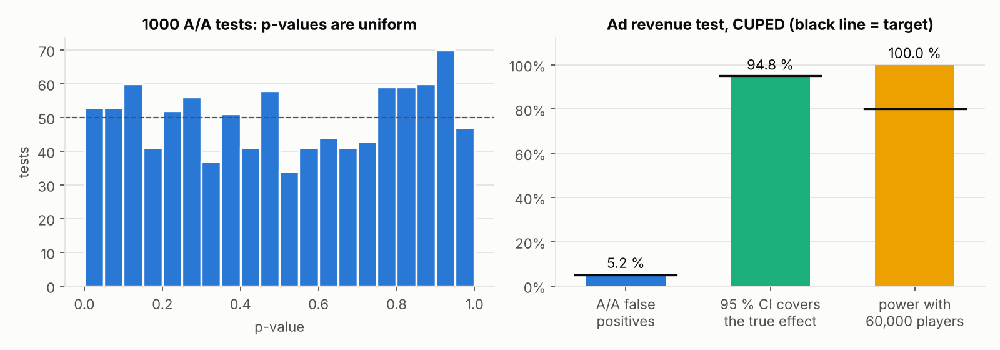
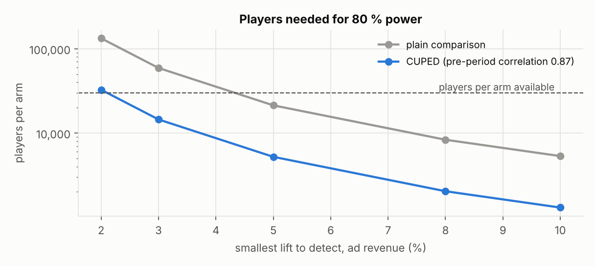
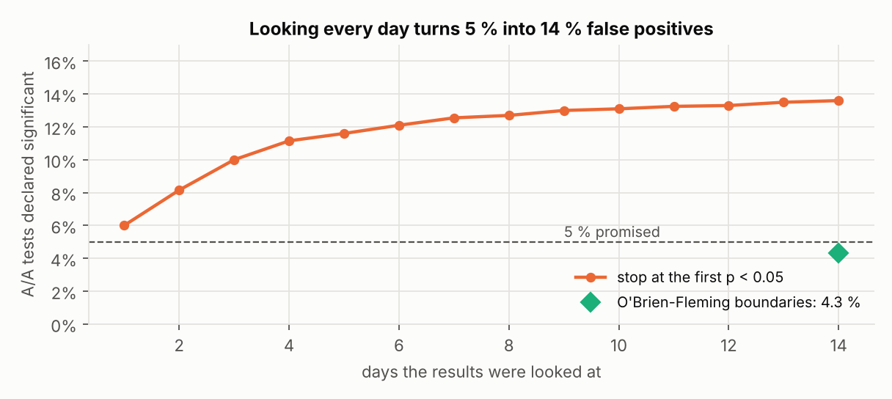
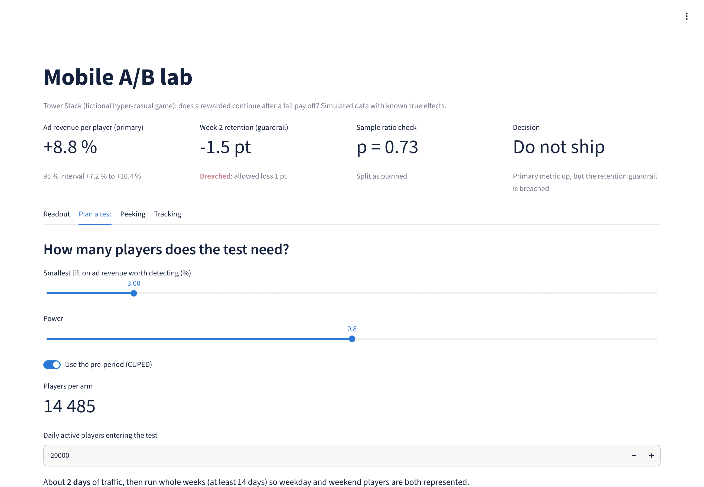
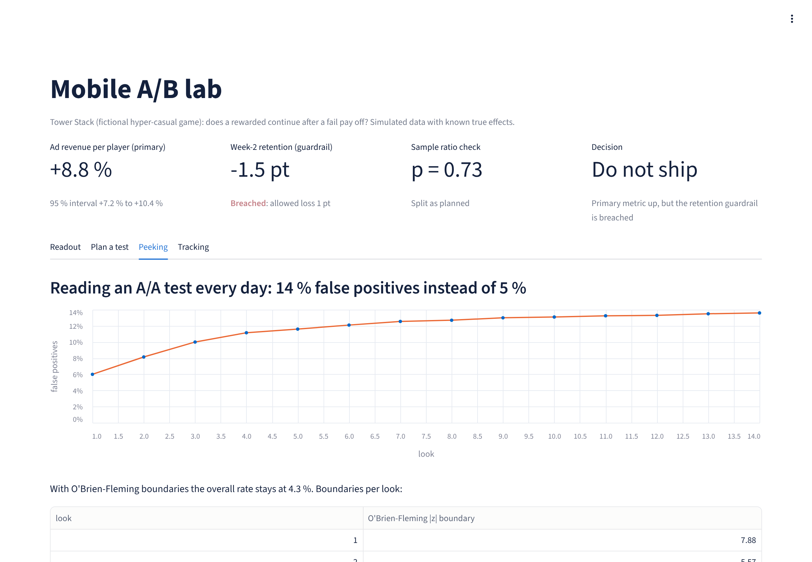
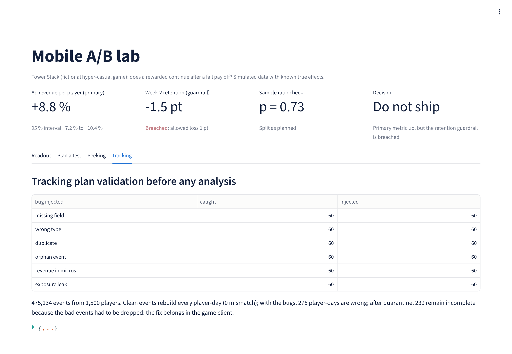

# mobile-ab-lab

**A complete A/B test on a mobile game, from the tracking plan to the ship decision, with statistics that check
themselves.**

   



**Tower Stack** is a fictional one-tap hyper-casual game. The product team wants to add a **rewarded continue**:
after a fail, the player can watch an ad to keep the tower. More rewarded ads should mean more revenue, but more ads
can also push players away. This repository runs the experiment end to end on 60,000 simulated players and reaches
a decision.

Every player is simulated **under both versions** with the same random draws, so the true effect is known. That is
what makes the statistics checkable: an interval that claims 95 % must contain the truth 95 % of the time.

| Step | What the repository does | Where |
|---|---|---|
| Tracking plan | 7 events with required fields, types and allowed values; validator; 6 kinds of bugs injected | [`data/tracking_plan.json`](data/tracking_plan.json), [`abtest/events.py`](abtest/events.py) |
| Metrics in SQL | Player metrics and pre-period covariates; events rebuilt into player-days and reconciled | [`abtest/metrics.py`](abtest/metrics.py) |
| Design | Deterministic assignment by hashing, sample size with and without CUPED | [`abtest/stats.py`](abtest/stats.py) |
| Readout | Sample ratio check, primary metric with CUPED, guardrail as a non-inferiority test, secondary metrics with Holm, novelty, segments | [`abtest/analysis.py`](abtest/analysis.py) |
| Self-checks | 1,000 A/A tests, coverage of the true effect, power, peeking with 2,000 daily-read A/A tests | [`abtest/analysis.py`](abtest/analysis.py) |
| Decision memo | Generated from the results | [`docs/readout.md`](docs/readout.md) |
| Dashboard | Readout, sample size planner, peeking, tracking | [`app.py`](app.py) |

## Decision: do not ship as is



| Metric (14 days, 60,000 players) | Control | Continue | Effect | 95 % interval | True effect |
|---|---:|---:|---:|---|---:|
| **Ad revenue per player** (primary, CUPED) | $0.202 | $0.220 | **+8.8 %** | +7.2 % to +10.4 % | +8.1 % |
| **Week-2 retention** (guardrail, allowed loss 1 pt) | 70.4 % | 68.8 % | **-1.5 pt** | lower bound -2.1 pt | -1.7 pt |
| Active days | 3.37 | 3.18 | -5.7 % | -6.6 % to -4.8 % | -6.1 % |
| Total revenue | $0.285 | $0.305 | +6.7 % | -1.9 % to +15.3 % (not significant) | +5.2 % |

* **The continue sells ads, but players come back less.** Week-2 retention loses 1.5 points, beyond the 1-point
  margin fixed before the test, and active days drop by 6 %.
* **The gain fades.** Ad revenue is up 16 % on day 0 and only about 4 % in the last four days: part of the effect is
  novelty, while the retention loss stays.
* **Total revenue cannot be read in two weeks.** In-app purchases make it extremely noisy (coefficient of variation
  7.3): detecting a 5 % change would take about 172,000 players per arm. That is why ad revenue, which the feature acts
  on directly, was chosen as the primary metric before the test.
* **Next step:** a capped version (one continue every other session) against control for 4 weeks, with the same
  guardrail and a 5 % long-term holdout on whatever ships.



## Can these numbers be trusted?

### Tracking first

Before any metric, the raw events of 1,500 players (475,134 events) are checked against the tracking plan.

| Bug injected (60 of each) | Caught |
|---|---:|
| Missing required field | 60 / 60 |
| Wrong type (revenue sent as text) | 60 / 60 |
| Duplicate sent by a retry | 60 / 60 |
| Event outside any session | 60 / 60 |
| Ad revenue in micros instead of dollars | 60 / 60 |
| Continue used by a control player (exposure leak) | 60 / 60 |

No false alarm on clean events, and clean events rebuild every player-day exactly in SQL. With the bugs, 275
player-days are wrong; quarantining the bad events still leaves 239 incomplete. **The fix belongs in the game client,
not in the dashboard.**

### Statistics that check themselves



* **1,000 A/A tests**: 5.2 % false positives for a 5 % test, and uniform p-values.
* **Coverage**: 94.8 % of the 95 % intervals contain the true effect.
* **CUPED** uses each player's two weeks before the test: 75 % less variance on ad revenue, so the same precision with
  a quarter of the players.



### Peeking



Reading an A/A test every day and stopping at the first p < 0.05 produces **14 % false positives instead of 5 %**.
O'Brien-Fleming boundaries (|z| > 7.9 on day 1, down to 2.1 on day 14) keep the overall rate at 4.3 % while still
allowing an early stop for a large effect.

### Sample ratio mismatch

When the exposure event fails on old devices for 890 treated players, the sample ratio check fires (p = 0.0009) and
the readout is declared invalid. Without the check, the retention loss would have been read as -0.9 pt instead of
-1.7 pt: **the bug hides almost half of the harm**.

## Dashboard

| Plan a test | Peeking | Tracking |
|---|---|---|
|  |  |  |

`exports/` holds a player table and daily totals by arm and country tier, ready to load in Power BI.

## Run

```bash
pip install -r requirements.txt
pytest -q             # 10 tests, a few seconds
python run.py         # about 1 minute: results/, docs/figures/, docs/readout.md, exports/
streamlit run app.py  # dashboard
```

## Limits

* The game, its players and the feature are simulated. The mechanisms (novelty, ad fatigue, heavy-tailed purchases)
  are realistic; the numbers are not a claim about any real game.
* Players are existing actives assigned on day 0. A test on new installs would need install cohorts and day-N
  retention instead.
* The segments are exploratory and not corrected for multiple testing: they suggest the next test, they do not decide.

## License

MIT
